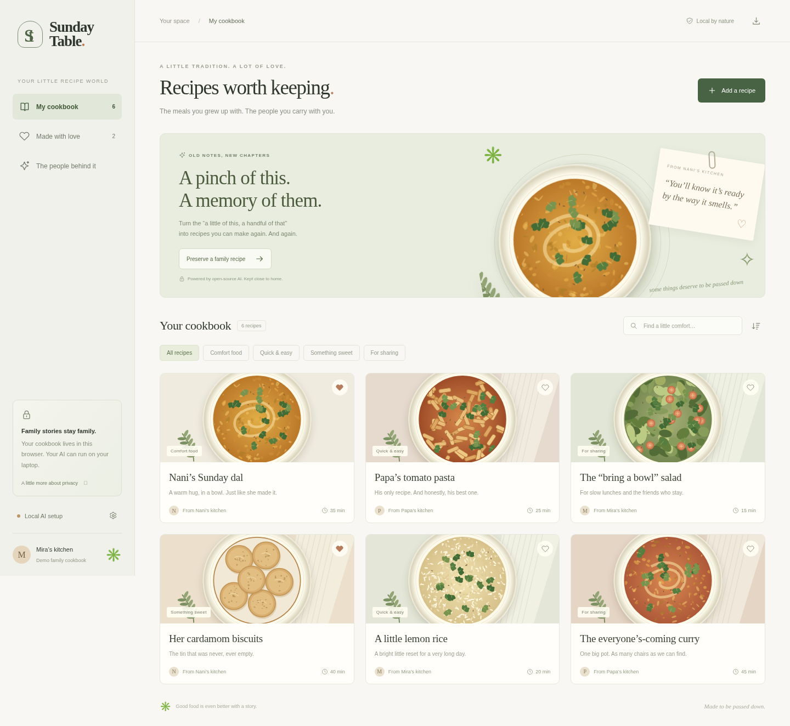

# Sunday Table

**A little home for the recipes that mean the most.**

Sunday Table turns scattered family cooking notes into an editable, personal cookbook using an open-weight model running through Ollama. Keep the recipe, keep the original words, and keep control of where the data goes.



Built for the **Build for a Friend** theme. The included “Mira and Nani” family is an **illustrative demo persona**. Replace it with a real friend’s story, with their permission, for a submission that satisfies the event’s real-person requirement.

## Run in one command

Requires Python 3.10+; Python 3.12 is recommended. No runtime packages, API keys, npm build, database, account, or paid service are required for the app.

```sh
python3 server.py
```

Open `http://127.0.0.1:8000` in a browser on the same computer. Manual editing, sample recipes, favorites, search, export, and import work immediately. The server binds to loopback by default.

### Connect the open-source AI

1. Install [Ollama](https://ollama.com) on the same computer.
2. Download the model:

   ```sh
   ollama pull qwen2.5:1.5b
   ```

3. Keep the Ollama desktop app running, or start `ollama serve` in another terminal.
4. Open **Local AI setup → Check connection** in Sunday Table.
5. Choose **Add a recipe**, paste a recipe note, and click **Make it a recipe**. Review and edit every field before saving.

The initial model download needs internet. After downloading the model, the app and inference can run without internet when the Python server and Ollama both run locally. Allow roughly 1 GB for model weights plus runtime memory; 4 GB of free RAM is a practical starting point. CPU inference can take a minute or more, depending on hardware and input length. A GPU is optional.

The **sample draft** button opens a prewritten example. It is prominently labeled and **never presented as a live AI result**.

### Configuration

| Variable | Default | Purpose |
| --- | --- | --- |
| `SUNDAY_MODEL` | `qwen2.5:1.5b` | Installed Ollama model to use |
| `OLLAMA_URL` | `http://127.0.0.1:11434` | Ollama server address |
| `PORT` | `8000` | App port |
| `HOST` | `127.0.0.1` | App bind address |

You can swap to another Ollama model that supports structured output:

```sh
ollama pull qwen2.5:3b
SUNDAY_MODEL=qwen2.5:3b python3 server.py
```

Keep this single-user prototype on a trusted computer. It has no multi-user authentication, TLS termination, or public-hosting hardening. If `OLLAMA_URL` points at another computer, notes are sent to that computer; do not describe that deployment as entirely on-device.

## What works

- Responsive illustrated cookbook with six clearly identified sample recipes.
- Search titles, authors, descriptions, and ingredients; filter by collection.
- Favorite recipes and browse by the person behind them.
- Create, edit, and delete recipes; changes persist in this browser.
- Local AI extraction with a JSON schema, low-temperature prompt, and server-side validation.
- Human review before saving, including a visible list of missing or ambiguous details.
- Original notes preserved alongside the edited recipe.
- Ingredient checklists, a print layout, individual Markdown downloads.
- Portable JSON cookbook backups and additive imports that preserve existing recipe IDs.
- Connection checks, model errors, and validation failures without silently substituting a fake AI response.
- Entirely bundled SVG artwork, system fonts, and no tracking or third-party requests from the interface.

## Why open innovation matters

**The model is part of the product, not a badge.** Qwen 2.5 interprets informal notes, separates ingredients from steps, preserves the speaker’s voice, and flags information the note never supplied. Ollama provides the inference runtime and constrained JSON output. The app validates that output and makes the user review it.

Qwen2.5-1.5B is an open-weight model under Apache 2.0; Ollama is open source under MIT. These third-party licenses do not license Sunday Table itself. No license is granted for the Sunday Table source code; all rights are reserved by its copyright holders. Model weights are downloaded separately and are not included in this repository.

This approach makes three things possible:

1. **Personal stories can stay on a computer you control.** There is no hosted AI endpoint in the default setup.
2. **The workflow can work without internet after installation.** A recipe can be preserved at the kitchen table without cloud inference access.
3. **You can change the model and its behavior.** Model selection is an environment variable, and the prompt and schema live in `server.py`. There are no provider API fees, though hardware, electricity, and download costs still apply.

These are architectural advantages of the local open approach, not a claimed accuracy or speed benchmark against a closed model. Smaller local models can be slower or less capable; review remains essential.

## Privacy and data

Recipe data lives in `localStorage` in the current browser profile and origin. It is **not encrypted**, synchronized, or automatically backed up. Anyone who can access that browser profile can access the cookbook. Export regularly before clearing browser data or moving computers. An export contains your recipes and their original notes.

AI extraction sends the entered note to the Python app server, which forwards it to the configured Ollama server. Sunday Table does not persist request bodies on disk. Default HTTP logs include paths and response statuses, not recipe notes. Ollama’s own runtime behavior is controlled by its installation.

AI is not an allergy, nutrition, or food-safety authority. Verify ingredients, quantities, temperatures, and preparation steps. This prototype accepts typed notes and pasted transcripts; it does not transcribe audio or read photographs.

## Validation

Standard-library API integration suite:

```sh
python3 -m unittest discover -s tests -v
```

Browser suite, with the app running in another terminal:

```sh
python3 -m venv .venv
. .venv/bin/activate
pip install -r requirements-dev.txt
python -m playwright install chromium
python tests/browser_smoke.py
```

For an existing Chromium installation:

```sh
CHROMIUM_PATH=/usr/bin/chromium python tests/browser_smoke.py
```

The browser suite includes an assertion for **disconnected Ollama**. Run it with the app configured to an unused Ollama port if you already have Ollama running, for example `OLLAMA_URL=http://127.0.0.1:11435 python3 server.py`.

Real-model smoke check after Ollama is connected:

```sh
python3 scripts/check_model.py
```

**Current validation:** 10 API integration tests and 13 browser workflow checks passed, including mobile layouts at 390, 768, and 1024 pixels. The success-path model response in those tests is a labeled fixture. The separate real-model smoke check has also passed locally with `qwen2.5:1.5b`; review model output manually because a smoke check does not prove accuracy.

## Project map

```text
server.py                  Local HTTP server, Ollama bridge, schema and prompt
static/index.html          App structure and dialogs
static/style.css           Responsive interface and print layout
static/app.js              Cookbook state, editing, import/export and AI review
static/*.svg               Original bundled food illustrations and icon
scripts/check_model.py     Real-model end-to-end smoke check
scripts/record_demo.py      Record the live local-AI walkthrough
tests/                    API and browser checks
docs/SUBMISSION.md         Submission post, demo script and handoff checklist
docs/screenshots/         Desktop, recipe, review and mobile captures
```

See [the submission kit](docs/SUBMISSION.md) for a post and a short demo plan.
